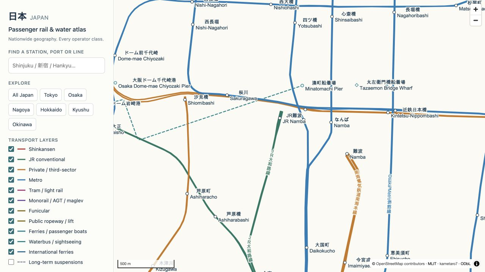
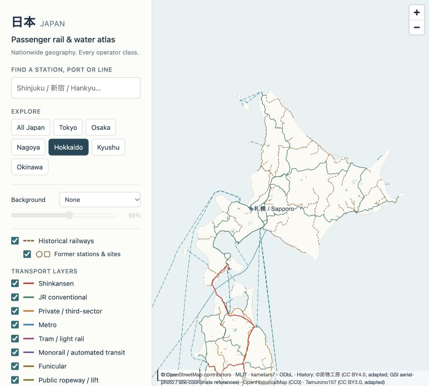

# Japan Rail & Water Atlas

**A geographic atlas of Japan's passenger transport and railway history.**

Explore current railways and scheduled passenger boats alongside former
railways, tramways, forest lines and industrial networks. Geography is retained;
labels and track detail are rendered at the scale of the view.

**[Explore the live atlas](https://maar10herr.github.io/japan-rail-water-atlas/)** ·
**[Download the single-file map](https://github.com/Maar10Herr/japan-rail-water-atlas/releases/download/v0.3.0/japan-rail-water-atlas.html)** ·
**[Maps & releases](https://github.com/Maar10Herr/japan-rail-water-atlas/releases)**



Source URLs, component licenses, inventories, coverage audits and SHA-256
checksums accompany the map.

## What you can explore

- **JR and Shinkansen**, alongside private and third-sector railways, including
  Hankyu, Kintetsu, Nankai, Meitetsu, Tobu, Seibu and the other mapped operators.
- **Metro, tram, monorail, AGT and maglev** networks, plus funiculars and curated
  public ropeways and lifts.
- **Scheduled water transport** on the sea, lakes and rivers: ferries,
  passenger launches, waterbuses and sightseeing boats, with selectable
  Japan-serving international routes.
- **Historical railways**, including former passenger lines, tramways, rural
  light railways, coal and forest lines, and the Minami-Daitō sugar railway.
  Former stations and documented industrial sites can be shown separately.
- **Japanese and English station search**, including romanized operator aliases.
- **Clickable stations and lines**, with nearby mapped geometry and available
  operator, timetable and OpenStreetMap links.
- **Layer filters, language selection and PNG export**. A separate option shows
  long-term suspensions; the background selector adds OpenStreetMap roads/buildings or GSI aerial imagery.

The project aims for broad nationwide coverage. It does **not** claim that every
passenger service has been individually verified or that the inventory is
literally exhaustive. Geometry uncertainty is represented in the map and
documented in the [coverage notes](docs/COVERAGE.md).

## The network, by the numbers

| Dataset component | Count | What the number means |
| --- | ---: | --- |
| Interactive route groups | 2,313 | Groups of geometry sharing a mode, operator, name and geometry-quality class |
| Source line sections | 96,088 | Mapped geometry sections, including parallel tracks and suspension context |
| Current-network station and terminal objects | 11,103 | Searchable point objects; an interchange can have several |
| Railway stop/station objects in the current selection | 9,304 | OSM station/stop objects, not distinct commercial stations |
| Water-service records | 587 | 565 marked active and 22 marked suspended in the assembled inventory |
| MLIT passenger-operator directory entries cross-matched | 204 | Operator-level matches, not independent verification of every route |
| Historical line features | 5,712 | Source paths or mapped fragments, including former industrial infrastructure |
| Historical station objects | 2,267 | Former source locations/boarding places; not a count of unique passenger stations |
| Historical station objects in Hokkaido | 803 | Regional subset of the historical point selection |
| Historical industrial-site markers | 3 | Representative locations where a complete alignment is unavailable |

**Object counts are not service counts or route-kilometres.** Two parallel
tracks are two pieces of geometry. Two operators at one interchange may be two
station objects. One ferry service may contain several legs.

The [station review records](data/reviews/) preserve source evidence for naming,
romanization, public access and operational-status decisions. There are still
133 unnamed objects and 1,426 labels without supported Latin text.

The input baselines are the Geofabrik/OSM snapshot from **2026-10-24**, MLIT's
**2022** national railway inventory and the upstream ferry inventory from
**2026-09-13**, supplemented by selected operator checks. This is a versioned
dataset, not a live transport feed.

Historical coverage combines OpenStreetMap, OpenHistoricalMap, freely licensed
Naeboworks reconstructions and source-specific industrial history. It is
partial and combines multiple eras. Its counts do not describe one railway
network that existed simultaneously.

## Using the map

Choose **All Japan** for the national view or one of the regional presets.
Search for a station, port, line or operator in Japanese or English. Selecting
a station zooms to it and shows nearby mapped lines.

Station names appear from zoom 10.5. At zoom 16.7 and above, all visible mapped
station names are allowed to appear. **Show overlapping station names** enables
that behavior sooner. Very close station objects can still overlap; zoom
further or select one to isolate its label. English names fall back to Japanese
where an English value is missing.

Water routes use dashes. Short dashes distinguish approximate, partial or direct
connections from mapped geometry. A hollow diamond identifies a sightseeing
departure whose fixed circuit is unavailable. Grey suspension layers are off
by default.

Enable **Historical railways** to overlay the combined historical record.
**Former stations & sites** controls its point markers. Historical search and
popups provide source links, available dates and geometry notes. Different eras
remain visible together; there is no single-year reconstruction. An operator
or alignment period ending is not necessarily closure of the whole railway.

The historical layer distinguishes mapped remnants, source reconstructions,
approximate alignments and site-only markers. Minami-Daitō's seven sugar-railway
sections are adapted from a schematic with a conservative **1 km display
uncertainty**, rather than surveyed track positions. Miyako's documented
prewar sugar railway is represented by its factory site: research records
about **9 km of track around 1939**, but an unsupported route is not drawn.



**Background** offers OpenStreetMap roads, buildings and place labels, or GSI
national aerial imagery with satellite mosaics at smaller scales. Use the
opacity slider to keep transport lines in the foreground. Choosing **None**
leaves the embedded transport map and coastline. Background tiles require an
internet connection; the transport geometry and search are embedded.

The background selection, opacity and map position are included in the URL.
OpenStreetMap tiles are loaded only for the current view, with ordinary browser
caching. There is no bulk or offline tile download. Aerial imagery has varying
capture dates and resolution.

**Save this view as PNG** exports the current map canvas with source attribution.

## Run locally

The repository includes a ready-to-serve `index.html`. Python's standard library
is enough:

```sh
git clone https://github.com/Maar10Herr/japan-rail-water-atlas.git
cd japan-rail-water-atlas
python3 -m http.server 8000 --bind 127.0.0.1
```

Open [localhost:8000](http://localhost:8000). A current desktop browser with
WebGL support is recommended. The renderer, worker, compressed dataset and
styles are bundled; the core map does not require an account or API key.

## Build and check

Edit the application in `src/`, then rebuild the single-file site:

```sh
python3 tools/history/build_payload.py
python3 tools/history/build_payload.py --check
python3 tools/build.py
python3 tools/build.py --check
python3 tools/validate.py
node --check src/app.mjs
node --check src/history.mjs
```

The builders use Python's standard library and make no network requests.
The historical builder compiles checked-in source components and reviews into
the combined historical payload. Run it when those inputs or selection rules
change; an ordinary web rebuild uses the checked-in payload directly.
`--check` compares the generated bytes with the committed `index.html`.
The historical check compares exact normalized JSON and audit bytes without
recompressing the frozen payload; gzip output can vary by Python/zlib version.
Validation checks dataset hashes, geometry types, point/search alignment,
counts and station-to-route references. GitHub Actions runs the same checks.

The checked-in payload makes the **web build** reproducible. Re-creating the
national GIS compilation from raw upstream data is a separate operation;
sources change, and several classifications were manually reviewed. See
[methods](docs/METHODS.md) before replacing the data.

## Under the hood

```text
data/atlas.json.gz + data/history.json.gz + src/ + vendor/
                  │
           tools/build.py
                  │
              index.html
                  │
     browser decompression + MapLibre worker
                  │
       GeoJSON → in-browser vector tiles
                  │
         WebGL lines + local-font labels
```

MapLibre tiles the embedded GeoJSON in a worker and renders it with WebGL.
Labels are drawn for the current zoom rather than baked into a national image.
The app uses local fonts, including CJK fallbacks, instead of requiring a remote
glyph service. Map coordinates use WGS84; the interactive projection is Web
Mercator.

The current-network static national export uses Lambert conformal conic with
standard parallels 30°N and 46°N and a central meridian of 136°E. Its **36,000 × 44,000** pixels add
up to **1.584 gigapixels**. An uncompressed RGBA buffer at that size is about
**5.9 GiB**. The interactive map is the more convenient way to inspect a station;
the raster is there for the large-format cartography crowd.

## Downloads and data

| Artifact | Location |
| --- | --- |
| Self-contained interactive HTML | [Release download](https://github.com/Maar10Herr/japan-rail-water-atlas/releases/download/v0.3.0/japan-rail-water-atlas.html) |
| Historical payload, source components and provenance | [Historical data ZIP](https://github.com/Maar10Herr/japan-rail-water-atlas/releases/download/v0.3.0/japan-historical-railways-data.zip) |
| 36,000 × 44,000 national PNG — current-network snapshot | [v0.2.0 PNG](https://github.com/Maar10Herr/japan-rail-water-atlas/releases/download/v0.2.0/japan-national-36000x44000.png) |
| Nine 10,000 × 12,600 regional PNGs — current-network snapshots | [v0.2.0 regional ZIP](https://github.com/Maar10Herr/japan-rail-water-atlas/releases/download/v0.2.0/japan-regional-details.zip) |
| Interactive payload | [`data/atlas.json.gz`](data/atlas.json.gz) |
| Historical interactive payload | [`data/history.json.gz`](data/history.json.gz) |
| Historical source components, point CSV and audit records | [`data/history/`](data/history/) |
| Selected line sections as compressed WGS84 GeoJSON | [`data/network.geojson.gz`](data/network.geojson.gz) |
| Ground lines, station/terminal points and water services | [`data/inventories/`](data/inventories/) |
| Current-network baseline comparison and ferry-operator matching | [`data/audits/`](data/audits/) |
| Renderer and bundled dependency source | [Source distribution](https://github.com/Maar10Herr/japan-rail-water-atlas/releases/download/v0.2.0/renderer-corresponding-source.zip) |
| Station identity and inclusion evidence | [`data/reviews/`](data/reviews/) |
| Snapshot metadata and SHA-256 checksums | [`data/manifest.json`](data/manifest.json) |

The regional sheets cover Tokyo/Kanto, Osaka–Kyoto–Kobe, Nagoya, the Seto Inland
Sea, northern Kyushu, Sapporo/southern Hokkaido, Okinawa/Sakishima, the central
mountains/Fuji/Hakone and Izu/Ogasawara.
The v0.2.0 PNGs retain that release's current-network selection and do not
contain the historical overlay. Use the interactive map's PNG export to save
a historical view.

Historical components are also available individually: [OSM](data/history/osm.geojson.gz),
[Naeboworks Hokkaido](data/history/naeboworks-hokkaido.geojson.gz),
[Naeboworks other regions](data/history/naeboworks-regions.geojson.gz),
[OpenHistoricalMap](data/history/ohm.geojson.gz),
[Okinawa sugar railway](data/history/okinawa-sugar.geojson.gz) and
[Kitadaitō site](data/history/kitadaito-site.geojson).
These preserve source-level coverage; the interactive selection also applies
the published [integration audit](data/history/integration-audit.json).

To inspect the payload without installing a GIS stack:

```python
import gzip
import json

with gzip.open("data/atlas.json.gz", "rt", encoding="utf-8") as stream:
    atlas = json.load(stream)

print(atlas["count"])
print(atlas["search"][0])  # Original object ID, bilingual name, coordinates, nearby route IDs
```

## What the map does not tell you

The geometry is useful for exploring networks. It is not a timetable, a routing
graph or proof that a particular train calls at a station. Nearby mapped lines
are selected by geographic proximity. A ferry's drawn connection is not a
navigational track.

Some current service states, minor crossings, public lifts and heritage
operations still need better evidence. Of the 565 active water-service records,
104 have no fixed circuit geometry and are represented by departure markers.
The [coverage report](docs/COVERAGE.md) separates that limitation from geometry
and naming quality.

Historical coverage varies by source and region. Missing dates remain missing,
source fragments are not connected across gaps, and industrial-site markers
are not passenger stations. Unbuilt railway projects and physical disaster
damage are not automatically classified as formerly operating lines. The
[historical coverage notes](docs/COVERAGE.md#historical-railways) explain these
distinctions and the evidence available for Hokkaido and the Okinawan islands.

## Sources, attribution and licenses

The principal sources are [OpenStreetMap](https://www.openstreetmap.org/copyright),
[Geofabrik](https://download.geofabrik.de/asia/japan.html),
[MLIT National Land Numerical Information](https://nlftp.mlit.go.jp/ksj/gml/datalist/KsjTmplt-N02-v3_1.html),
the [MLIT passenger-operator directory](https://www.mlit.go.jp/maritime/bosai_shipslink.html),
and [kametaro7/japan-ferry-map](https://github.com/kametaro7/japan-ferry-map).
The optional aerial imagery is supplied by [GSI Japan](https://maps.gsi.go.jp/development/ichiran.html).
Historical sources include [Naeboworks / 苗穂工房](https://naeboworks.com/haisen/),
[OpenHistoricalMap](https://www.openhistoricalmap.org/copyright) and
[Tamurono157's Minami-Daitō diagram](https://commons.wikimedia.org/wiki/File:Minami-Daito-Sugartrain-line.gif).
The renderer is [MapLibre GL JS](https://maplibre.org/); its source distribution
and build instructions are described in [`vendor/README.md`](vendor/README.md).

Original application code and documentation are licensed under **GPL v3 only**. OSM-derived
data is ODbL; Naeboworks data is **CC BY 4.0**, selected OHM features are **CC0**,
and the adapted Minami-Daitō diagram is **CC BY 3.0** with separately credited
geographic registration. The bundled renderer and other components retain
their own terms. **The code license does not relicense the data.** Read
[NOTICE.md](NOTICE.md) and [source provenance](docs/SOURCES.md) before reusing it.

Missing a railway, a little crossing, or a better station name? Contributions
with primary-source evidence are welcome. See [CONTRIBUTING.md](CONTRIBUTING.md).
